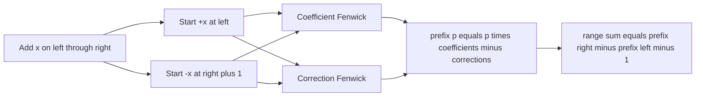

# Horrible Queries

- Official problem: [SPOJ — Horrible Queries](https://www.spoj.com/problems/HORRIBLE/)
- USACO Guide ID: `spoj-HorribleQueries`
- Difficulty on the checked USACO Guide listing: Easy
- Topics: Fenwick tree, range addition, range sum
- Solution: [`solutions/spoj-HorribleQueries.cpp`](../../solutions/spoj-HorribleQueries.cpp)

## Paraphrased summary

For each test case, begin with a zero-filled array. Process commands that either add one value to every position in an inclusive interval or report the sum of an inclusive interval.

## Visualization

Think about a range addition as two events in a difference array: start adding at `left`, then stop adding immediately after `right`. A prefix of the original array contains a growing contribution from each active event, so two Fenwick trees store the slope and the start-position correction.

## Approach

For a range addition of `x` beginning at position `l`, its contribution to a prefix ending at `p` is `x * (p-l+1)`. Rewrite this as `p*x - x*(l-1)`. The first Fenwick tree accumulates the `x` coefficients and the second accumulates the correction `x*(l-1)`.

Record the start event at `l`. Record the matching negative event at `r+1`, so the contribution stops beyond the updated range. Then a prefix sum is `p * coefficientPrefix(p) - correctionPrefix(p)`, and any interval sum is the difference of two prefixes.

## Why it is correct

Consider one update adding `x` on `[l,r]`. Before `l`, neither boundary event is included, so it contributes zero. For a prefix endpoint `p` inside `[l,r]`, only the start event is included and the formula gives `p*x - x*(l-1) = x*(p-l+1)`, exactly the sum of the affected positions. After `r`, both boundary events are included; together they produce the constant `x*(r-l+1)`, the update's entire contribution. Fenwick sums add these correct contributions for every update. Subtracting the prefix through `left-1` from the prefix through `right` therefore returns exactly the requested range sum.

## Complexity

- Each update: `O(log n)`.
- Each sum query: `O(log n)`.
- Space: `O(n)`.

## Verification notes

Tests compare random command streams with a literal array, batch many test cases to catch missed resets, cover one-element and boundary intervals, and reach `N=C=100,000` with a result near `10^17` to verify 64-bit arithmetic.
