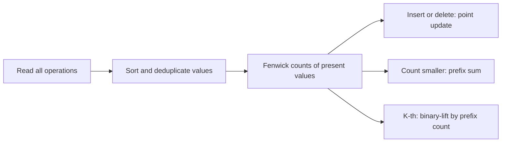

# Ordered Set

- Official problem: [SPOJ ORDERSET — Order statistic set](https://www.spoj.com/problems/ORDERSET/)
- USACO Guide ID: `spoj-OrderSet`
- Difficulty on the checked USACO Guide listing: Easy
- Topics: Fenwick tree, coordinate compression, order statistics
- Solution: [`solutions/spoj-OrderSet.cpp`](../../solutions/spoj-OrderSet.cpp)

## Paraphrased summary

Maintain a set of integers under insertion and deletion. Also answer how many stored values are smaller than a given number and return the value with a requested one-based rank, or report an invalid rank.

## Visualization

Coordinate compression puts every value mentioned by an update or count query on a sorted ruler. A Fenwick tree stores a one at present values and zero elsewhere.

## Approach

1. Read all operations and collect every numeric value used by `I`, `D`, or `C`.
2. Sort and deduplicate those values to create compressed indices.
3. Store whether each value is present, and keep its zero-or-one count in a Fenwick tree.
4. Insert or delete with a point update only when membership actually changes.
5. For `C x`, find the first compressed value at least `x`; the Fenwick prefix before it counts stored values smaller than `x`.
6. For `K k`, reject `k` larger than the set size. Otherwise binary-lift through the Fenwick tree to find the first prefix count reaching `k`.

## Why it is correct

Compression preserves the strict order of all relevant values. The Fenwick invariant stores one exactly at each present set element. Thus a prefix sum before `lower_bound(x)` counts exactly the elements smaller than `x`. For a valid rank `k`, Fenwick binary lifting finds the largest prefix containing fewer than `k` elements, so the next index is precisely the `k`-th present value. Membership checks ensure duplicate insertions and missing deletions are no-ops, matching set semantics.

## Complexity

- Preprocessing: `O(Q log Q)`.
- Each operation: `O(log Q)`.
- Space: `O(Q)`.

## Verification notes

The verifier compares random command streams with Python's sorted-set behavior, emphasizes duplicate updates and extreme signed values, checks the official example, and runs a two-hundred-thousand-operation stress case.
