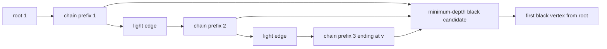

# Query on a tree again!

- Official problem: [SPOJ QTREE3](https://www.spoj.com/problems/QTREE3/en/)
- USACO Guide ID: `spoj-QueryOnATreeAgain`
- Difficulty on the checked USACO Guide listing: Easy
- Listing evidence: [Heavy-Light Decomposition module at Guide commit `31e29ac`](https://github.com/cpinitiative/usaco-guide/blob/31e29ac00c138376c6f443b0129181261997c270/content/5_Plat/HLD.problems.json)
- Topics: heavy-light decomposition, segment tree, root-path queries
- Solution: [`solutions/spoj-QueryOnATreeAgain.cpp`](../../solutions/spoj-QueryOnATreeAgain.cpp)

## Paraphrased summary

Every tree vertex starts white. One operation flips a chosen vertex between white and black. Another operation names a vertex and asks for the first black vertex encountered while walking from root `1` toward it, or `-1` when that path contains no black vertex.

## Visualization

Heavy-light decomposition cuts one root path into only a few chain intervals.

The segment tree stores `(depth, vertex)` for black vertices and infinity for white vertices. Taking the smallest candidate over every path piece therefore selects the black vertex closest to the root.

## Approach

Root the tree at `1`, compute subtree sizes, and mark each largest-child edge as heavy. Write every heavy chain into consecutive array positions. A toggle changes one segment-tree leaf between `(depth, vertex)` and infinity.

For a query at `v`, query the interval from `v`'s chain head through `v`, jump to the parent of that head, and repeat until reaching the root's chain. Query the remaining root-chain prefix and return the candidate with minimum depth.

## Why it is correct

Each queried HLD interval contains exactly one consecutive piece of the root-to-`v` path. Jumping above a chain head removes that piece and preserves the unprocessed root path, so the intervals are disjoint and together cover the complete path. Each interval query returns its shallowest black vertex. The minimum depth among those candidates is exactly the first black vertex reached from root `1`; if every candidate is infinity, the answer is `-1`. A toggle updates precisely the leaf representing that vertex.

## Complexity

- Preprocessing: `O(N log N)` with segment-tree initialization.
- Toggle: `O(log N)`.
- Root-path query: `O(log^2 N)`.
- Memory: `O(N)`.

## Verification notes

Random tests compare every query with a direct parent walk from the named vertex to root `1`. A 100,000-node chain with 100,000 operations checks maximum depth, repeated toggles, root answers, absent answers, and nonrecursive traversal.
