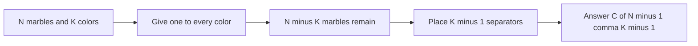

# MARBLES - Marbles

- Official problem: [SPOJ MARBLES](https://www.spoj.com/problems/MARBLES/)
- USACO Guide ID: `spoj-marbles`
- Difficulty on the checked USACO Guide listing: Easy
- Topics: combinatorics, stars and bars, binomial coefficients
- Solution: [`solutions/spoj-marbles.cpp`](../../solutions/spoj-marbles.cpp)

## Paraphrased summary

Distribute `N` identical marbles among `K` colors so that every color receives at least one marble. Report the number of possible distributions for each test case.

## Visualization

After reserving one marble for each color, line up the remaining marbles as stars and place `K-1` separators to split them into color groups.

For example, `***|*||**` describes four positive group sizes after the reserved marble for each group is restored.

## Approach

1. Reserve one marble for every color so positivity is automatic.
2. Use stars and bars: the answer is `C(N-1,K-1)`.
3. Replace `k` by `min(k,n-k)` to use the shorter side of the binomial coefficient.
4. Build the coefficient with the exact recurrence `result = result * (n-k+i) / i`.
5. Use a 128-bit temporary for the multiplication, then store the guaranteed 64-bit result.

## Why it is correct

Every valid positive distribution becomes one nonnegative distribution after subtracting one marble from each color. Writing those remaining counts in order is equivalent to arranging `N-K` stars and `K-1` separators. Choosing the separator positions among `N-1` total positions gives `C(N-1,K-1)` possibilities. The mapping works in both directions and is unique, so the formula counts exactly the requested distributions. The multiplicative loop is the standard exact expansion of that binomial coefficient.

## Complexity

- Time: `O(min(K-1,N-K))` per test case.
- Space: `O(1)`.

## Verification notes

The repository compares the solution with Python's exact integer binomial function across fixed and random cases, checks `K=1`, `K=N`, symmetry, and large `N` cases that exercise the wide intermediate multiplication.
