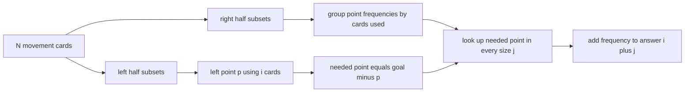

# Robot Instructions

- Source: USACO Silver
- USACO Guide ID: `usaco-1207`
- Difficulty at selection: Easy (checked in [Guide source commit ef5573b](https://github.com/cpinitiative/usaco-guide/blob/ef5573bfbe9dc873486eed6502d6439d9c7fa97a/content/4_Gold/Meet_In_The_Middle.problems.json))
- Original problem: [USACO 2022 February Silver](https://usaco.org/index.php?page=viewproblem2&cpid=1207)
- Tags: Meet in the Middle, Two-Dimensional Subset Sums, Counting
- Solution: [C++](../../solutions/usaco-1207.cpp)

## Problem Summary

A robot begins at the origin and has up to forty distinct movement instructions. For every selection size from one through `N`, count the subsets of exactly that many instructions whose combined displacement reaches the requested coordinate.

This is a paraphrased study summary. Refer to the official page for the complete statement and constraints.

## Visualization Description

Split the movement cards into left and right piles. Each subset produces a dot `(sum_x, sum_y)` labeled with the number of cards used. For a left dot, reflect it through the goal to locate the required right dot. Add the right dot's frequency into the bucket labeled `left size + right size`.

## Approach

Split the instructions into two halves. Enumerate all right-half subsets and store the frequency of each displacement in a hash map for its subset size. Then enumerate every left-half subset. If it uses `i` moves and reaches `(x,y)`, its right partner must reach `(goal_x-x, goal_y-y)`. Look up that point in every right-size map `j` and add its frequency to `answer[i+j]`.

Coordinates and answers use 64-bit integers: coordinates can accumulate forty billion-scale movements, and as many as `2^40` subsets may share a result.

## Correctness

Every full instruction subset decomposes uniquely into a left subset and a right subset. Suppose the left subset uses `i` instructions and has displacement `p`. The full subset reaches the goal exactly when its right displacement is `goal-p`; if the right subset uses `j` instructions, it belongs in output bucket `i+j`. The algorithm performs exactly this lookup and adds every matching right subset's frequency. Hence every valid subset is counted once in the correct size bucket, and every counted pair reaches the goal.

## Complexity

- Expected time: `O(N * 2^(N/2))`
- Space: `O(2^(N/2))`

## Verification

The smoke test uses the official sample. The independent verifier compares every size bucket with complete enumeration on random small two-dimensional moves and checks negative coordinates, duplicate displacements, cancellation, unreachable goals, and a forty-instruction binomial-count stress case.
