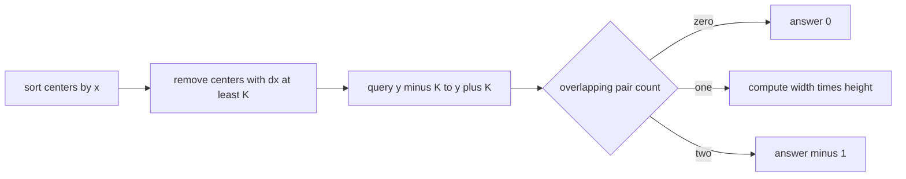

# Square Overlap

- Official problem: [USACO 2013 January Silver — Square Overlap](https://usaco.org/index.php?page=viewproblem2&cpid=227)
- USACO Guide ID: `usaco-227`
- Difficulty on the checked USACO Guide listing: Easy
- Listing evidence: [Sweep Line module at Guide commit `5addb3e`](https://github.com/cpinitiative/usaco-guide/blob/5addb3eedcaddea38292dd70129482ae7057155c/content/5_Plat/Sweep_Line.problems.json)
- Topics: sweep line, ordered sets, rectangle intersection
- Solution: [`solutions/usaco-227.cpp`](../../solutions/usaco-227.cpp)

## Paraphrased summary

Many equal, axis-aligned squares are specified by their distinct integer centers and common even side length. Print zero if no pair shares positive area, the shared area if exactly one pair overlaps, or `-1` if at least two pairs overlap.

## Visualization

After sorting centers by `x`, keep only earlier centers less than one side length away horizontally. Among those, an ordered set restricts attention to centers less than one side length away vertically.

## Approach

1. Sort centers by `x`.
2. Maintain an active set of earlier centers with horizontal distance strictly below `K`.
3. Store the active centers by `y` and query only the strict range `|dy| < K`.
4. Each candidate is one positive-area overlap. Stop and print `-1` when the second pair is found.
5. For the unique pair, compute `(K-|dx|)(K-|dy|)`.

## Why it is correct

Two equal axis-aligned squares overlap with positive width exactly when `|dx| < K`, and with positive height exactly when `|dy| < K`; both conditions are necessary and sufficient for positive shared area. The sliding window contains exactly the earlier centers satisfying the first condition, while the ordered-set range returns exactly those satisfying the second. Therefore every overlapping pair is found once, when its later center is processed, and no non-overlapping pair is counted. The output rule then matches the number of pairs found, and the rectangle product is the exact area for the unique pair.

## Complexity

- Time: `O(N log N)`; a second overlap ends the scan, while inputs with at most one overlap examine at most one candidate overall.
- Memory: `O(N)` for sorted centers and the active set.

## Verification notes

Checks include no overlap, edge and corner touching, one contained intersection region, several overlapping pairs, equal `x` or `y` coordinates, extreme coordinates and side length, the official sample, and randomized cases compared with all `O(N^2)` pairs.
