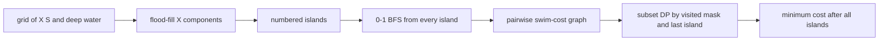

# Island Travels

- Source: USACO Gold
- USACO Guide ID: `usaco-230`
- Difficulty at selection: Easy (checked in [Guide source commit ef5573b](https://github.com/cpinitiative/usaco-guide/blob/ef5573bfbe9dc873486eed6502d6439d9c7fa97a/content/4_Gold/Conclusion.problems.json))
- Original problem: [USACO 2013 January Gold](http://www.usaco.org/index.php?page=viewproblem2&cpid=230)
- Tags: Flood Fill, 0-1 BFS, Bitmask DP
- Solution: [C++](../../solutions/usaco-230.cpp)

## Problem Summary

A map contains island land, shallow water, and impassable deep water. Starting on any island, visit every island while minimizing how many shallow-water cells are entered. Land movement is free, and the map contains at most fifteen islands.

This is a paraphrased study summary. Refer to the official page for the complete statement and constraints.

## Visualization Description

First color each connected land mass with its own island number. Next replace the grid with a complete weighted graph: each vertex is an island, and an edge weight is the least number of shallow cells needed to travel between its endpoints. Finally, light up visited-island subsets while a route moves through that graph.

## Approach

Flood-fill adjacent `X` cells to label the islands. For each island, run multi-source 0-1 BFS from all its cells: entering land costs zero, entering `S` costs one, and `.` is forbidden. The resulting distances yield the cheapest travel cost between every pair of islands.

Then use bitmask DP. `dp[mask][last]` is the least swimming needed to visit all islands in `mask` and finish at `last`. Every singleton state has cost zero because the initial landing island is arbitrary. Add each unvisited next island using the precomputed pair cost.

## Correctness

Flood fill labels exactly the maximal connected land components. For a fixed source island, 0-1 BFS minimizes the sum of zero-cost land steps and one-cost shallow-water entries, so each pairwise edge is the true minimum swimming cost. Any complete visit order corresponds to a sequence of subset-DP transitions with the same or lower pairwise-optimal cost. Conversely, each DP transition is a realizable grid trip and eventually visits its mask. Therefore the minimum full-mask state is exactly the least total swimming needed to visit every island.

## Complexity

For `K` islands and an `R x C` grid:

- Time: `O(KRC + K^2 2^K)`
- Space: `O(RC + K^2 + K2^K)`

## Verification

The smoke test uses the official sample. The independent verifier labels random small maps, computes pair distances with an independent heap-based shortest-path oracle, tries every island order, and compares the result. It also checks one island, blocked deep water, multi-cell islands, and a maximum fifteen-island chain.
