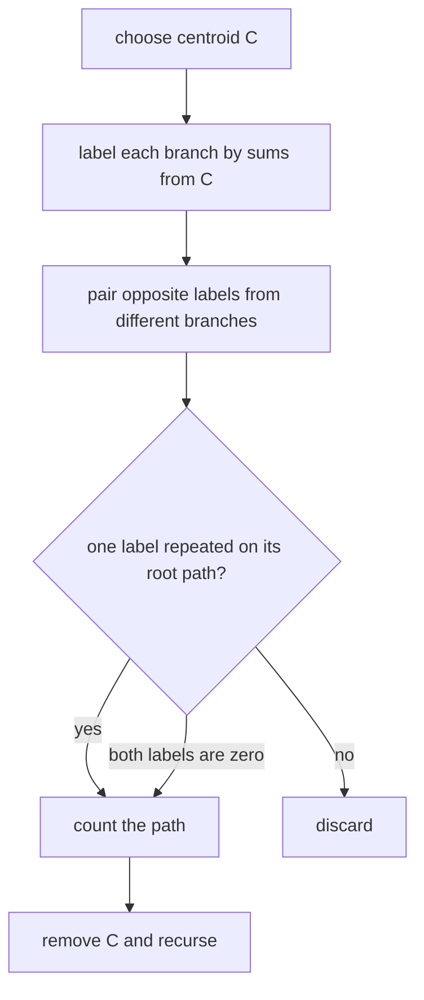

# Yin and Yang

- Official problem: [USACO 2013 US Open Gold — Yin and Yang](https://usaco.org/index.php?page=viewproblem2&cpid=286)
- USACO Guide ID: `usaco-286`
- Difficulty on the checked USACO Guide listing: Easy
- Listing evidence: [Centroid Decomposition module at Guide commit `a426215`](https://github.com/cpinitiative/usaco-guide/blob/a4262152bce8c42a33ac73a631913a84b02a5ea4/content/5_Plat/Centroid.problems.json)
- Topics: centroid decomposition, path sums, frequency counting
- Solution: [`solutions/usaco-286.cpp`](../../solutions/usaco-286.cpp)

## Paraphrased summary

A tree edge has one of two colors. Count unordered paths with different endpoints for which some internal vertex splits the path into two parts, each containing equal numbers of the two colors. Count a path once even if several split vertices work.

## Visualization

Replace the colors by `+1` and `-1`. From a chosen centroid `C`, label every vertex with its path sum from `C`. A path joining different centroid branches has total zero when the two endpoint labels are opposites. It has a valid internal split when one endpoint's label has already appeared earlier on its route toward `C`; when both labels are zero, `C` itself is the split.

For example, sums `+2, +1, +2` down one branch mark the last vertex as reusable: the two equal `+2` prefixes enclose a zero-sum segment. Pair that endpoint with `-2` in another branch, and the whole route and both sides of the rest stop are balanced.

## Approach

1. Convert edge type `0` to `+1` and type `1` to `-1`.
2. Find the centroid of the active component.
3. Traverse each centroid-neighbor branch with an enter/exit DFS. Maintain balance frequencies on only the current root path, recording whether the current balance occurred at a strictly earlier internal vertex.
4. Merge branches one at a time. A total histogram counts previously seen endpoints with the opposite balance. A second histogram counts endpoints without a usable repeated balance; subtract those only when the new endpoint is also unusable.
5. Separately count centroid-to-vertex paths whose zero balance repeats at a genuinely internal vertex, because the centroid is an endpoint and cannot be the rest stop.
6. Remove the centroid and repeat in every remaining component.

## Why it is correct

For a path through centroid `C`, let endpoint labels be `a` and `b`. Its color difference is `a+b`, so balance requires `b=-a`. A rest stop in the first branch exists exactly when an earlier prefix has the same label `a`; subtracting equal prefix sums gives zero. The same statement holds in the second branch. If `a=b=0`, `C` is itself a legal internal rest stop. Thus the histogram rule counts exactly the valid cross-branch paths. The special centroid-endpoint rule excludes `C` as a rest stop and requires another internal zero.

Every tree path has a unique first centroid whose removal separates its endpoints, or equals one endpoint. It is evaluated at exactly that decomposition step and never again, so no path is missed or counted twice.

## Complexity

- Time: `O(N log N)`.
- Memory: `O(N)`.

## Verification notes

Random trees are checked against a literal oracle that reconstructs every path and tries every internal rest stop. The official sample, all-one-color trees, alternating chains, stars, and the 100,000-node limit are covered. Original-tree traversals are iterative; only logarithmic-depth centroid recursion remains.
