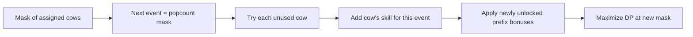

# Cow Decathlon

- Official problem: [USACO 2014 February Gold — Cow Decathlon](https://usaco.org/index.php?page=viewproblem2&cpid=401)
- USACO Guide ID: `usaco-401`
- Difficulty on the checked USACO Guide listing: Easy
- Topics: bitmasks, assignment dynamic programming, bonus thresholds
- Solution: [`solutions/usaco-401.cpp`](../../solutions/usaco-401.cpp)

## Paraphrased summary

There are equally many cows and events. Every cow must receive a different event, and the assignment earns that cow's skill score for the event. After certain event prefixes, the running total may earn positive bonuses. Find the largest possible final score.

## Visualization

Imagine filling an event schedule from left to right. A bitmask is a row of switches: switch `i` is on exactly when cow `i` already has an event. The number of on switches identifies the next event automatically.

## Approach

1. Group every bonus by the prefix length where it is checked.
2. Sort the bonuses for one prefix by required score.
3. Let `dp[mask]` be the best score after the cows in `mask` fill the first `popcount(mask)` events.
4. Try assigning every unused cow to the next event.
5. After adding that skill score, scan the bonuses for the newly completed prefix. Add each award whose threshold is met.
6. Maximize the state for the mask containing the chosen cow.

Sorting same-prefix bonuses matters: a smaller-threshold award may lift the score over a larger threshold. Bonuses for earlier prefixes are already included in the DP score.

## Why it is correct

Every valid full assignment has one unique path through the masks: after event `k`, the mask contains exactly the cows assigned to the first `k` events. The transition tries every possible unused cow, so it includes every valid next assignment. For any resulting prefix, bonuses are applied in nondecreasing threshold order; therefore every bonus made reachable either by skills or earlier awards is included. Keeping only the maximum score for a mask is safe because future choices and bonus rules depend on that score and the used-cow set, and a larger score can never reduce a future reward. Thus the full-mask value is the optimum.

## Complexity

- Time: `O(N(B+1)2^N)` in the worst case, with both `N` and `B` at most 20.
- Space: `O(2^N + N^2 + B)`.

## Verification notes

The repository checks the official sample, exhaustive cow-to-event permutations on random small instances with cascading bonuses, duplicate prefix rules, and a 20-cow constraint-scale case.
