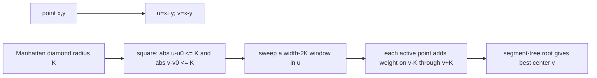

# The Lazy Cow

- Official problem: [USACO — The Lazy Cow](https://usaco.org/index.php?page=viewproblem2&cpid=418)
- USACO Guide ID: `usaco-418`
- Difficulty on the checked USACO Guide listing: Easy
- Topics: Manhattan geometry, coordinate rotation, sweep line, lazy segment tree
- Solution: [`solutions/usaco-418.cpp`](../../solutions/usaco-418.cpp)

## Paraphrased summary

Weighted grass patches lie at distinct points. Choose any starting point and collect the greatest possible total weight among patches whose north-south-plus-east-west distance from that point is at most `K`.

## Visualization

A Manhattan-distance ball is a diamond in the original plane. Rotating coordinates with `u=x+y` and `v=x-y` turns the diamond into an axis-aligned square, so the problem becomes finding a maximum-weight square of width `2K`.

## Approach

Transform every patch to `(u,v)=(x+y,x-y)` and sort by `u`. Two pointers keep every patch whose `u` coordinate can fit with the current right endpoint inside a width-`2K` window.

For an active patch at coordinate `v`, a center can reach it exactly when its own transformed `v` coordinate lies in `[v-K,v+K]`. Coordinate-compress all such endpoints. A lazy segment tree adds the patch's grass to that whole interval when it enters the sweep and subtracts it when it leaves. The tree root is the best total over all possible center `v` coordinates.

## Why it is correct

The coordinate identity `max(|dx+dy|,|dx-dy|)=|dx|+|dy|` makes the transformed square condition exactly equivalent to the original step limit. For a fixed sweep window, the segment tree adds each active patch to precisely the center coordinates that can reach it, so every leaf value equals the grass reachable by that center and the root stores the best one. Any optimal square can slide in `u` until its right edge meets its rightmost contained patch; that configuration appears in the sweep. Therefore the maximum root value is the global optimum.

## Complexity

- Time: `O(N log N)`.
- Space: `O(N)`.

## Verification notes

Tests include the official sample, random distinct-point cases checked by enumerating transformed squares, boundary inclusion at distance exactly `K`, negative transformed `v` values, and `N=100,000` patches whose total reaches one billion.
