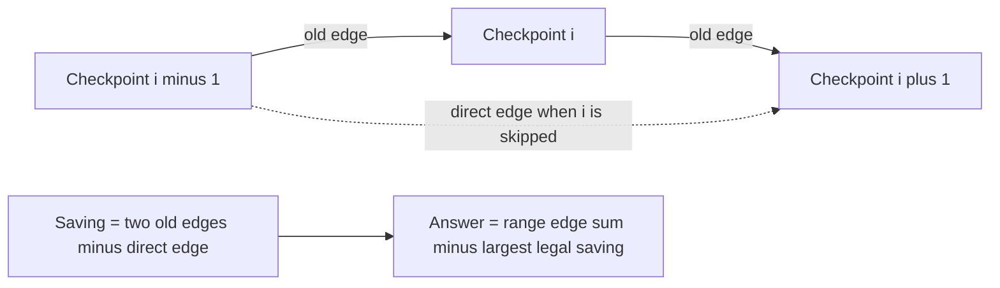

# Marathon

- Official problem: [USACO 2014 December Gold — Marathon](https://usaco.org/index.php?page=viewproblem2&cpid=495)
- USACO Guide ID: `usaco-495`
- Difficulty on the checked USACO Guide listing: Easy
- Topics: segment tree, Manhattan distance, range sum, range maximum
- Solution: [`solutions/usaco-495.cpp`](../../solutions/usaco-495.cpp)

## Paraphrased summary

A route visits checkpoints in order on a city grid. Answer sub-route distance questions when one interior checkpoint may be skipped, while also processing checkpoint-coordinate updates.

## Visualization

The normal route is a sum of adjacent edge lengths. Skipping checkpoint `i` replaces the two edges touching it with one direct edge, producing a local saving.

## Approach

1. Store every adjacent Manhattan distance as an edge value.
2. For each interior checkpoint, store the distance saved by skipping it: `dist(i-1,i) + dist(i,i+1) - dist(i-1,i+1)`.
3. Maintain edge sums and skip-savings maxima in segment trees.
4. A query from `l` to `r` takes the sum of edges `[l,r)` and subtracts the largest saving whose middle checkpoint lies strictly inside the sub-route.
5. Moving checkpoint `i` changes only edges `i-1` and `i`, plus skip values centered at `i-1`, `i`, and `i+1`; update only those positions.

## Why it is correct

Without a skip, the required route has exactly the adjacent edges from `l` through `r-1`, so their range sum is its distance. Skipping an interior checkpoint changes only its two incident edges and replaces them with the direct edge between its neighbors. Thus each legal skip reduces the total by exactly its stored saving, and the shortest allowed route subtracts the maximum saving. Endpoints are excluded by the queried saving range. After a coordinate update, every geometric quantity containing the moved point is among the two edges and three triples refreshed, while all other values remain valid.

## Complexity

- Build: `O(n log n)` in this implementation.
- Update: `O(log n)`.
- Query: `O(log n)`.
- Space: `O(n)`.

## Verification notes

The repository checks the official example, one- and two-checkpoint routes, collinear and repeated points, random updates and queries against direct enumeration of every legal skip, and 100,000 checkpoints and operations.
