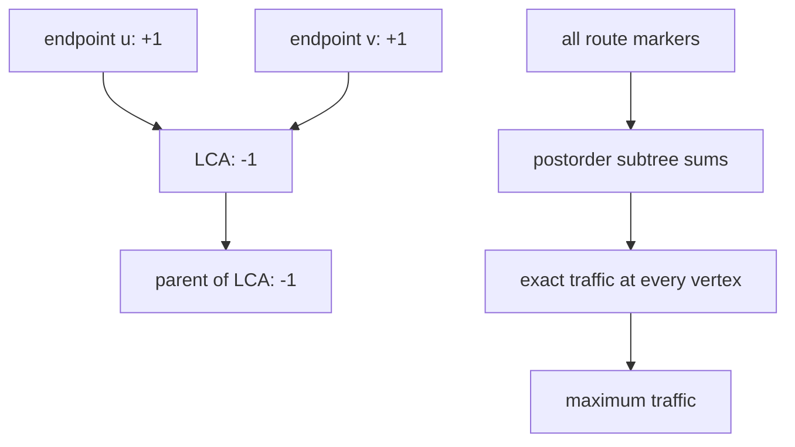

# Max Flow

- Official problem: [USACO December 2015 Platinum — Max Flow](http://www.usaco.org/index.php?page=viewproblem2&cpid=576)
- USACO Guide ID: `usaco-576`
- Difficulty on the checked USACO Guide listing: Easy
- Listing evidence: [Binary Jump module at Guide commit `81e547a`](https://github.com/cpinitiative/usaco-guide/blob/81e547ad50a16109b5b5ed582bc6a6397479ce2b/content/5_Plat/Binary_Jump.problems.json)
- Topics: lowest common ancestor, binary lifting, tree difference arrays
- Solution: [`solutions/usaco-576.cpp`](../../solutions/usaco-576.cpp)

## Paraphrased summary

A tree carries many requested routes, each using the unique path between two vertices. Count how many routes pass through every vertex and report the largest count. Route endpoints are included.

## Visualization

Place difference markers at the endpoints and around the lowest common ancestor, then collect every subtree upward once.

The two negative markers cancel flow immediately above the inclusive path while leaving the LCA counted once.

## Approach

Root the tree and build a binary-lifting table for lowest common ancestors. For each route `(u, v)` with `w = lca(u, v)`, add one at `u` and `v`, subtract one at `w`, and subtract one at `parent(w)`. Finally, process vertices from children to parents, adding each difference value into its parent. The resulting value at a vertex is its route count.

An iterative traversal records parent-before-child order, so reversing that order provides the needed postorder without risking recursion depth.

## Why it is correct

Consider one route. Endpoint markers flow upward during subtree accumulation. Below the LCA, exactly the branches leading to the two endpoints carry one. At the LCA, the two incoming units plus its `-1` marker leave one, so the LCA is included. The `-1` at its parent cancels that remaining unit before it can reach any strict ancestor. Therefore this route contributes exactly one to every vertex on its path and zero elsewhere. Summing markers for all routes preserves this property by linearity, so the maximum accumulated value is the answer.

## Complexity

- Preprocessing: `O(N log N)`.
- Route processing: `O(K log N)`.
- Final accumulation: `O(N)`.
- Memory: `O(N log N)`.

## Verification notes

The smoke test uses overlapping paths whose busiest central vertex is easy to inspect. Random trees and paths are checked against literal path enumeration. Special cases cover identical endpoints, routes through the root, stars, long chains, repeated routes, and maximum `N` and `K`.
