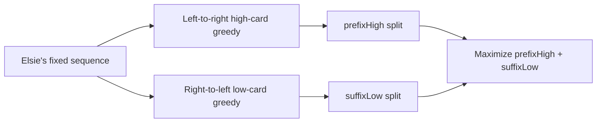

# High Card Low Card

- Official problem: [USACO 2015 December Platinum — High Card Low Card](https://usaco.org/index.php?page=viewproblem2&cpid=577)
- USACO Guide ID: `usaco-577`
- Difficulty on the checked USACO Guide listing: Easy
- Topics: greedy matching, prefix and suffix preprocessing, ordered sets
- Solution: [`solutions/usaco-577.cpp`](../../solutions/usaco-577.cpp)

## Paraphrased summary

Elsie reveals the fixed order of her half of a numbered deck. Bessie plays each of her complementary cards once. Early rounds award a point for the higher card; Bessie may choose one split after which later rounds award a point for the lower card. Find her maximum score.

## Visualization

Try every rule-switch boundary after preprocessing the best score on either side.

## Approach

Recover Bessie's hand as the cards from `1..2N` absent from Elsie's hand.

For every prefix, greedily count high-card wins: play the smallest available Bessie card strictly larger than Elsie's card. For every suffix, scan backward and greedily count low-card wins: play the largest available card strictly smaller than Elsie's. Evaluate all `N+1` split locations by adding the corresponding prefix and suffix counts.

## Why it is correct

For high-card rounds, replacing any winning choice with the smallest possible winning card cannot hurt later matches, because it preserves all larger cards. This exchange proves the prefix greedy maximum. Symmetrically, the largest card that is still smaller is optimal for low-card rounds, proving each suffix maximum. At a fixed split, ordered-card matchings have the interval exchange property: overlapping provisional winning cards can be exchanged toward larger cards on the high side and smaller cards on the low side until the winning sets are disjoint, without changing either win count. Unused cards fill losing rounds. Thus the sum is achievable for each split, and taking the maximum considers every legal switch time.

## Complexity

- Time: `O(N log N)`.
- Space: `O(N)`.

## Verification notes

Small random games are compared with exhaustive card permutations and every split. Tests also cover switching immediately, never switching, monotone and alternating orders, the official example, and the `N=50,000` limit.
