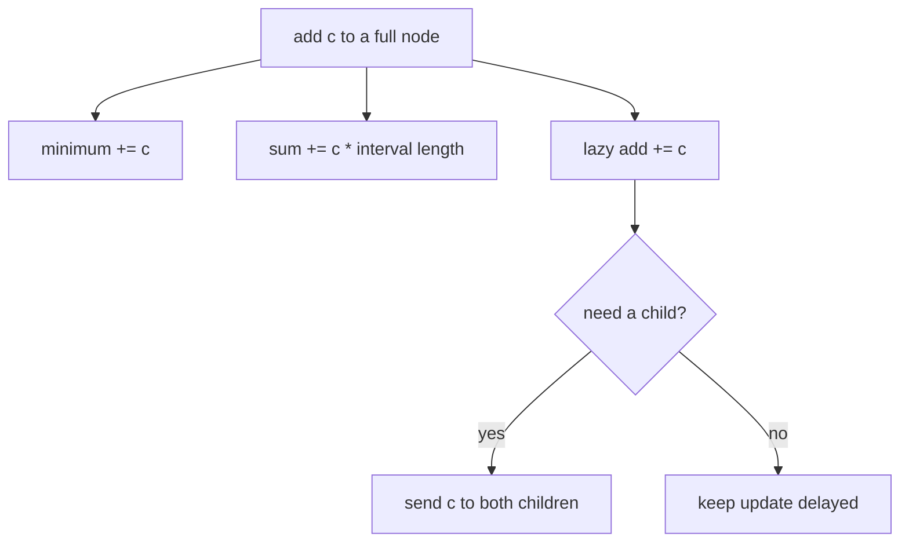

# Counting Haybales

- Official problem: [USACO — Counting Haybales](https://usaco.org/index.php?page=viewproblem2&cpid=578)
- USACO Guide ID: `usaco-578`
- Difficulty on the checked USACO Guide listing: Easy
- Topics: lazy segment tree, range addition, range minimum, range sum
- Solution: [`solutions/usaco-578.cpp`](../../solutions/usaco-578.cpp)

## Paraphrased summary

An array records haybale counts in consecutive fields. Instructions can add the same count across an interval, ask for the smallest count in an interval, or ask for the interval total.

## Visualization

One delayed addition changes both summaries predictably. The minimum rises once by the added amount, while the sum rises once for every field in the node.

## Approach

Each segment-tree node stores its interval minimum, interval sum, and a pending addition. A full-cover update adjusts the minimum by `c`, the sum by `c*length`, and accumulates `c` in the lazy tag. Before a partial update or query descends, push that tag to both children.

A minimum query merges answers with `min` and uses positive infinity for no overlap. A sum query merges with addition and uses zero for no overlap. The solution supports USACO file input when `haybales.in` exists and standard input otherwise.

## Why it is correct

Adding the same amount to every element raises the interval minimum by exactly that amount and raises the interval sum by the amount times the interval length, so a full-node update keeps both summaries exact. A pending tag records precisely the update children have not yet received. Pushing applies it to each child before the child is used. Therefore, by induction, every visited node has exact summaries, and taking the minimum or sum of the canonical query nodes returns the requested value.

## Complexity

- Build: `O(N)`.
- Each instruction: `O(log N)`.
- Space: `O(N)`.

## Verification notes

Tests use the official sample, compare random mixed operations with a literal array, include single-field and overlapping intervals, and reach `N=200,000`, `Q=100,000` with totals beyond 32-bit range.
