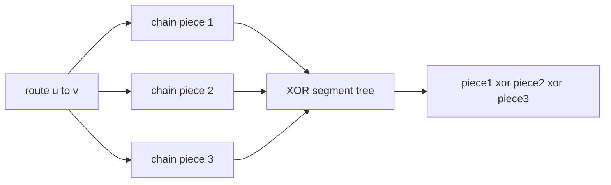

# Cow Land

- Official problem: [USACO Gold February 2019](https://www.usaco.org/index.php?page=viewproblem2&cpid=921)
- USACO Guide ID: `usaco-921`
- Difficulty on the checked USACO Guide listing: Easy
- Listing evidence: [Heavy-Light Decomposition module at Guide commit `81e547a`](https://github.com/cpinitiative/usaco-guide/blob/81e547ad50a16109b5b5ed582bc6a6397479ce2b/content/5_Plat/HLD.problems.json)
- Topics: heavy-light decomposition, segment tree, path XOR
- Solution: [`solutions/usaco-921.cpp`](../../solutions/usaco-921.cpp)

## Paraphrased summary

Attractions form a tree and each has an enjoyment value. An update replaces one attraction's value. A route query asks for the bitwise XOR of every attraction value on the unique path between two chosen attractions.

## Visualization

The decomposition is the same geometric idea as a path maximum; the segment tree combines pieces with XOR instead.

Because XOR is associative and commutative, chain pieces may be processed in any order without changing the route result.

## Approach

Use subtree sizes to choose a heavy child for every non-leaf vertex, then flatten each heavy chain into consecutive segment-tree positions. The tree preprocessing and decomposition are iterative to handle a maximum-depth chain safely.

To query a route, repeatedly process the deeper endpoint's segment from its chain head through the endpoint, XOR it into the answer, and move above that chain. When both endpoints share a chain, XOR the final interval. A value assignment updates one segment-tree leaf.

## Why it is correct

Each processed interval corresponds exactly to a consecutive section of the original route. Moving the endpoint to the chain head's parent removes precisely that section and leaves the rest of the route unchanged. The final same-chain interval completes a disjoint partition of the path, including both endpoints. XORing the values over all partition pieces equals the XOR over the entire route. Updating one leaf keeps the flattened value of every vertex accurate.

## Complexity

- Preprocessing: `O(N log N)` with the chosen segment-tree initialization.
- Update: `O(log N)`.
- Route query: `O(log^2 N)`.
- Memory: `O(N)`.

## Verification notes

Random tests rebuild each path with breadth-first search and XOR current values literally. Maximum `N` and `Q` chain tests cover zero values, endpoint inclusion, repeated assignments, self-path queries, and iterative preprocessing.
