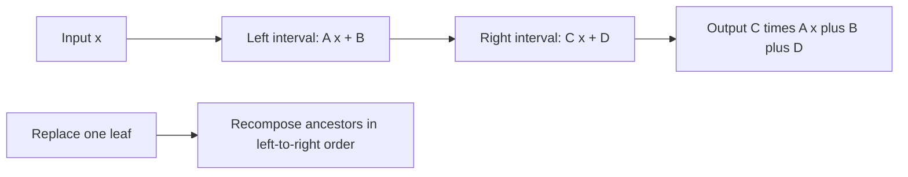

# Point Set Range Composite

- Official problem: [Library Checker — Point Set Range Composite](https://judge.yosupo.jp/problem/point_set_range_composite)
- USACO Guide ID: `ys-PointSetRangeComposite`
- Difficulty on the checked USACO Guide listing: Easy
- Topics: segment tree, affine functions, non-commutative operations
- Solution: [`solutions/ys-PointSetRangeComposite.cpp`](../../solutions/ys-PointSetRangeComposite.cpp)

## Paraphrased summary

Maintain an ordered array of functions of the form `f(x) = ax + b` modulo `998244353`. A point update replaces one function. A range query applies every function in a half-open interval from left to right to a supplied value.

## Visualization

Each leaf is one function. An internal node is the single affine function equivalent to applying its left interval and then its right interval.

## Approach

1. Represent an affine function by its multiplier and constant pair `(a,b)`.
2. Define `concatenate(first, second)` as `second(first(x))`. Its pair is `(second.a * first.a, second.a * first.b + second.b)` modulo `998244353`.
3. Build a segment tree with that associative combiner and identity function `(1,0)`.
4. For a point update, replace one leaf and recompute its ancestors.
5. For a range query, preserve order with separate left and right accumulators, concatenate them, and evaluate the result at `x`.

The separate accumulators are essential: function composition is associative but generally not commutative.

## Why it is correct

Every leaf stores exactly its array function. If two child nodes represent their function sequences correctly, `concatenate(left,right)` applies the entire left sequence followed by the entire right sequence, so their parent represents its complete interval. Induction proves this invariant for the built tree and after every point update. During a query, selected left nodes are appended in forward order and selected right nodes are prepended in forward order; their final concatenation is therefore exactly `f_(r-1)(...(f_l(x)))`. Evaluating that affine pair returns the requested answer.

## Complexity

- Build: `O(n)`.
- Point update: `O(log n)`.
- Range query: `O(log n)`.
- Space: `O(n)`.

## Verification notes

The repository checks deterministic examples, identity and one-element ranges, order-sensitive pairs, hundreds of random updates and queries against literal left-to-right evaluation, and a maximum-size operation stream.
